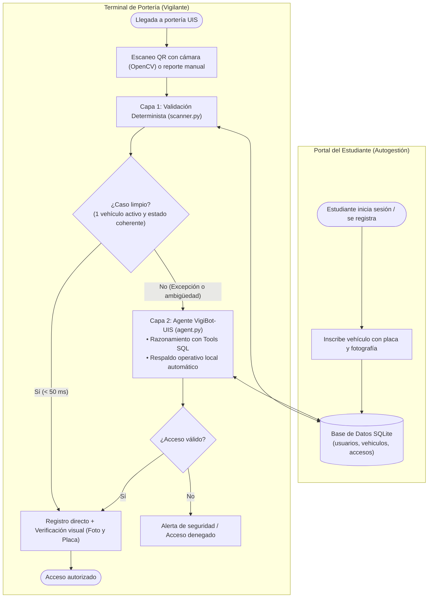

# [Gestión Vehicular UIS — VigiBot-UIS](https://www.canva.com/design/DAG519jwYAQ/B_YC-MGX8brhK1yA50BUSQ/edit)

Sistema híbrido para la modernización y automatización del control de acceso vehicular (carros, motos, bicicletas y monopatines) en la **Universidad Industrial de Santander**, integrando el código QR dinámico del carné digital institucional, visión por computadora y un agente supervisor con IA.

### Autores del Proyecto

| Nombre | Código |
| :--- | :---: |
| **Leider Yesid Gomez Giraldo** | `2232503` |
| **David Alejandro Galvis Duarte** | `2232522` |

---

## Arquitectura del Sistema

La plataforma conecta dos aplicaciones web sobre una base de datos compartida en **SQLite**:

1. **Portal de Autogestión Estudiantil (`pages/1_Portal_Estudiante.py`):**
   * Registro e inicio de sesión seguro mediante hash criptográfico `PBKDF2-SHA256`.
   * Autocompletado de código estudiantil leyendo el QR dinámico del carné digital UIS con **OpenCV**.
   * Inscripción de vehículos con **placa obligatoria** (para carros y motos), **fotografía obligatoria** para todos los medios de transporte y control de estado (`ACTIVO` / `INACTIVO`) para agilizar el paso diario.
2. **Terminal de Portería (`app.py`):**
   * **Indicadores de aforo en vivo:** Conteo automático de carros, motos, bicicletas y monopatines dentro del campus.
   * **Capa 1 — Programa Base Determinista (`scanner.py`):** Decodifica el Base64 del carné (`DOCUMENT`), valida el único vehículo activo y registra el acceso en **< 50 ms** desplegando su fotografía y placa para verificación visual del vigilante.
   * **Capa 2 — Agente Supervisor IA (`agent.py`):** Resuelve ambigüedades (múltiples vehículos activos), inconsistencias de entrada/salida y reportes en lenguaje natural mediante **Function Calling** sobre SQLite, con límite estricto de tiempo y respaldo operativo local ante alta demanda de red.

## Diagrama de Flujo del Proceso Propuesto



## Estructura del Proyecto

* `app.py`: Interfaz principal de la **Terminal de Portería** (escáner QR con cámara, métricas de aforo, verificación fotográfica y chat con VigiBot-UIS).
* `pages/1_Portal_Estudiante.py`: Módulo multipágina para el registro e inicio de sesión de estudiantes y gestión de sus vehículos.
* `scanner.py`: Capa 1 determinista para validación instantánea del código QR en Base64.
* `agent.py`: Capa 2 con **VigiBot-UIS**, control de latencia y respaldo determinista local.
* `tools.py`: Herramientas SQL (`consultar_historial_estudiante`, `registrar_movimiento_estudiante`, `ejecutar_consulta_sql_lectura`).
* `database.py`: Esquema de SQLite (`usuarios`, `vehiculos`, `accesos`), migraciones automáticas y seguridad de contraseñas.
* `main.py`: Simulador de pruebas por consola.

## Instalación y Uso Local

1. **Clonar el repositorio y activar el entorno virtual:**
   ```bash
   python3 -m venv .venv
   source .venv/bin/activate
   ```
2. **Instalar dependencias:**
   ```bash
   pip install -r requirements.txt
   ```
3. **Configurar variables de entorno:**
   Crea un archivo `.env` en la raíz a partir de `.env.example` y agrega tu clave de API:
   ```env
   GEMINI_API_KEY=tu_clave_aqui
   ```
4. **Ejecutar la aplicación web (Portería y Portal Estudiante):**
   ```bash
   streamlit run app.py
   ```
   *Cuentas de prueba precargadas en el Portal del Estudiante: códigos `2232503` y `2232504` con contraseña `uis2026`.*
